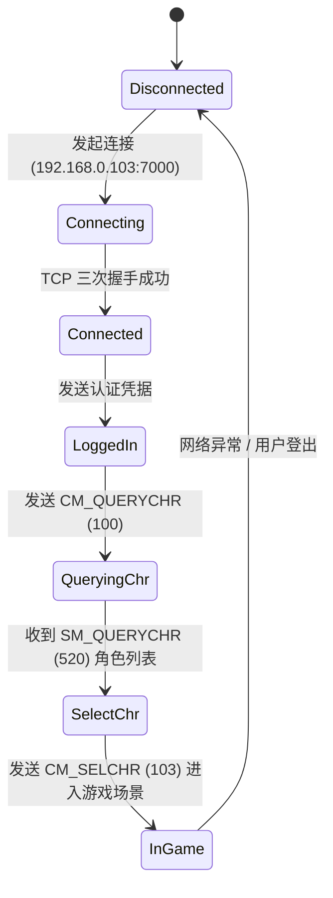

# OpenSpec 03: 业务生命周期与操作输入规范

## 1. 规范定位
本规范定义客户端的生命周期状态机、网络交互流转过程，以及键盘与鼠标操作的输入映射标准。

---

## 2. 客户端生命周期状态机 (Client State Machine)

客户端遵循以下阶段状态流转：



---

## 3. 核心网络交互流程 (Protocol Flow)

### 3.1 角色查询握手 (`CM_QUERYCHR` / `SM_QUERYCHR`)
- **客户端发送**：
  ```text
  #<16B EncodedMsg: Ident=100><Account/SessionKey>!
  ```
- **服务端响应**：
  ```text
  #<16B EncodedMsg: Ident=520><ChrName/Job/Level/Hair/Gender...>!
  ```
- **解析规则**：
  若 `Ident == 520`，则 Payload 包含该账号下已创建角色的详细属性（职业、等级、发型、性别）；
  若 `Ident == 527`，表示当前账号下无角色或查询失败。

---

## 4. 全量快捷键映射与交互标准 (Input Controls)

所有图形呈现端必须严格实现以下键位与鼠标行为：

### 4.1 键盘映射表

| 按键 | 命令 / 触发事件 | 说明 |
| :---: | :--- | :--- |
| `F1` ~ `F8` | `CastMagic(Slot 1~8)` | 释放对应快捷槽的主体技能 |
| `Ctrl + F1~F8` | `CastHeroMagic(Slot 1~8)`| 释放英雄/召唤物技能 |
| `F9` | `ToggleBagWindow()` | 打开 / 关闭包裹背包面板 |
| `F10` | `ToggleStatusWindow()` | 打开 / 关闭角色属性与装备面板 |
| `F11` | `ToggleSkillWindow()` | 打开 / 关闭技能树面板 |
| `F12` | `ToggleHelperOption()` | 打开 / 关闭内挂辅助选项 |
| `Esc` | `ToggleGroundItemText()`| 切换地面掉落物名字显示 / 关闭上层弹窗 |
| `Enter` | `FocusChatInput()` | 聚焦聊天输入框，再次回车发送消息 |
| `Ctrl + B` | `CM_QUERYBAGITEMS` | 刷新查看背包物品 |
| `Alt + X` | `ExitGame()` | 安全退出游戏 |

### 4.2 鼠标手感标准

- **右键按住**：计算鼠标相对于屏幕中心的角度，转换为 8 方向（北、东北、东、东南、南、西南、西、西北），每帧向服务端发送移动/奔跑包。
- **右键单击物品**：穿戴/卸下装备或使用药品。
- **`Shift` + 左键**：强制原地朝鼠标方向攻击（刺杀/挥刀）。
- **`Ctrl` + 左键**：强制锁定目标玩家。
- **`Alt` + 左键**：对尸体执行挖肉操作。

---

## 5. 控制台底板 HUD 布局与局部坐标系规范 (HUD Anchor System)

借鉴原版 Delphi `DWinCtl` 与 `FState.pas` 架构，游戏主控制台底板（`DBottom`）及其子组件必须采用**严格的父级相对局部坐标**：

- **父容器锚点与背景垫底**：
  底板贴图（`Prguse3: 371`）的中央聊天区域在设计上为透明镂空。因此在绘制底板前，底板矩形全域必须先铺垫深墨黑底色（`RGB: 14, 12, 10`），杜绝视口或白板穿透：
  ```csharp
  int boardW = bottomTex.Width; // 800
  int boardH = bottomTex.Height;
  int boardX = (screenWidth - boardW) / 2; // 宽屏居中
  int boardY = screenHeight - boardH;
  // 1. 底板全域深黑铺底
  Raylib.DrawRectangle(boardX, boardY, boardW, boardH, new Color(14, 12, 10, 255));
  ```
- **子元素相对偏移标准**（相对于 `boardX, boardY`）：
  - **双色玻璃血魔球 (HP/MP Ball)**：`boardX + 40, boardY + (boardH >= 200 ? 91 : (boardH - bh) / 2)`，精准嵌入底板凹槽
  - **经典聊天视窗 (Chat Box)**：`boardX + 195, boardY + 14`，依托底板自带镂空窗口渲染 6 行系统/聊天文本
  - **快捷技能槽 (F1 ~ F8 Slots)**：`boardX + 510, boardY + 14`，每个槽位 34x34，横向间距 4
  - **原生雕花红宝石圆钮交互区**：十周年底板右下角原生雕刻了 4 个圆形功能大按钮（半径约 15px），坐标分别位于：
    - 包裹：`boardX + 722, boardY + 98`
    - 状态：`boardX + 755, boardY + 98`
    - 行会：`boardX + 788, boardY + 98`
    - 退出：`boardX + 820, boardY + 98`（或依据面板等距分布），移除粗糙长条黑块，直接响应原生圆盘点击。

---

## 6. 地图三趟 Pass 渲染管线规范 (Three-Pass Map Pipeline)

借鉴原版 Delphi `PlayScn.pas` 架构，必须将地图渲染严格分解为三个独立的阶段（Pass），杜绝大瓦片盖碎建筑物：

1. **Pass 1: 底层大瓦片 (Tiles / BkImg)**
   - 跨度为 $2 \times 2$ 网格，尺寸 $96 \times 64$；
   - 仅在偶数行、偶数列（`x % 2 == 0 && y % 2 == 0`）且 `CleanBkIndex > 0` 时绘制；
   - 纹理索引采用 1-based 修正：`CleanBkIndex - 1`。
2. **Pass 2: 中层微地貌与道路瓦片 (SmTiles / MidImg)**
   - 跨度为 $1 \times 1$ 网格，逐格扫描覆盖；
   - 纹理索引采用 1-based 修正：`CleanMidIndex - 1`。
3. **Pass 3: 前景物体与光影 (Objects / FrImg)**
   - 建筑物、树木、城墙与路灯；
   - 纹理索引采用 1-based 修正：`CleanFrIndex - 1`；
   - 若 `(cell.AniFrame & 0x80) != 0`，代表发光光源（路灯/火把），启用 `BlendMode.Additive` 渲染光晕，否则按普通遮挡贴图绘制。

